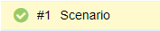
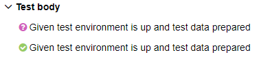

Extended Allure Listener for Kotest
=================================

[](https://adoptium.net/)
[](https://kotlinlang.org/)
[](https://kotest.io/)
[](https://gradle.org/)
[](https://central.sonatype.com/artifact/ru.iopump.kotest/kotest-allure)

This listener writes Kotest test cases, nested steps, fixtures, labels, and links to Allure 2 result files. Version 6.2.5 targets Kotest 6.2.5 and Java 21 bytecode. The library is built with Kotlin 2.2.21 and Allure Java 2.35.5. Use a Kotlin compiler that can consume Kotlin 2.2 metadata; Kotest 5 is outside this release's supported line.

# Quick Start

[Sample project](https://github.com/kochetkov-ma/pump-samples/tree/master/kotest-allure-sample)

### Install and register the listener

```groovy
plugins {
    id 'org.jetbrains.kotlin.jvm' version '2.2.21'
}

repositories {
    mavenCentral()
}

dependencies {
    testImplementation 'ru.iopump.kotest:kotest-allure:6.2.5'
    testImplementation 'io.kotest:kotest-runner-junit5-jvm:6.2.5'
}

tasks.withType(Test).configureEach {
    useJUnitPlatform()
}
```

### Choose a version

| Line | Kotest | Kotlin | Allure Java | Java bytecode | Maven Central coordinate | Release |
| --- | --- | --- | --- | --- | --- | --- |
| Current 6.2.5 | 6.2.5 | 2.2.21 | 2.35.5 | 21 | [`ru.iopump.kotest:kotest-allure:6.2.5`](https://central.sonatype.com/artifact/ru.iopump.kotest/kotest-allure/6.2.5) | [v6.2.5](https://github.com/kochetkov-ma/kotest-allure/releases/tag/v6.2.5) |
| Legacy 6.0.3 | 6.0.3 | 2.2.10 | 2.30.0 | 11 | [`ru.iopump.kotest:kotest-allure:6.0.3`](https://central.sonatype.com/artifact/ru.iopump.kotest/kotest-allure/6.0.3) | [v6.0.3](https://github.com/kochetkov-ma/kotest-allure/releases/tag/v6.0.3) |

Future work targets the latest `master` line (currently 6.2.5). The published 6.0.3 artifact remains resolvable for compatibility; no backports are planned. The Quick Start example above uses 6.2.5.

Register the listener once in a Kotest project configuration:

```kotlin
import io.kotest.core.config.AbstractProjectConfig
import ru.iopump.kotest.allure.KotestAllureListener

class ProjectConfig : AbstractProjectConfig() {
    override val extensions = listOf(KotestAllureListener)
}
```

If Kotest does not discover your configuration automatically, set `kotest.framework.config.fqn` to its fully qualified class name in the test task. Avoid registering a second Allure listener, including the Allure JUnit 5 adapter, or the report can contain duplicates.

### Results

Results are written to `build/allure-results` by default. Set the `allure.results.directory` system property to change the location. The listener clears that directory at project start by default; set `allure.results.directory.clear=false` to retain older files. A Gradle example:

```groovy
tasks.named('test', Test) {
    systemProperty 'allure.results.directory', layout.buildDirectory.dir('allure-results').get().asFile
}
```

### Reports

Use the [Allure Gradle plugin](https://github.com/allure-framework/allure-gradle) to turn these result files into an HTML report. Keep its JUnit 5 framework adapter disabled because this library already writes the Kotest results. Allure Java 2.35.5 produces results; Allure commandline 2.46.1 renders the report. They have separate version numbers.

```groovy
plugins {
    id 'io.qameta.allure' version '4.3.0'
}
allure {
    version = '2.46.1'
    adapter {
        allureJavaVersion = '2.35.5'
        autoconfigureListeners = false
        aspectjWeaver = true
        aspectjVersion = '1.9.25.1'
        frameworks {
            jupiter {
                enabled = false
            }
        }
    }
}
```

This repository uses the report-only `io.qameta.allure-report` plugin and a pinned AspectJ agent attached to each test task. That setup keeps normal, fixture, legacy example, and contract results in separate directories. `allureFixtureTest` captures deliberate failures and skips; `allureResultContractTest` checks raw result JSON and HTML. `./gradlew check` also runs `legacyExamplesContractTest`, which checks expected legacy outcomes. The report is under `build/reports/allure-report/allureReport`. The JDK 21 `check` run passed with intentional fixture and legacy failures isolated from the normal tests.

See [example](https://github.com/kochetkov-ma/pump-samples/tree/master/kotest-allure-sample)

## API

### Annotations

#### `@KDescription`

Specify test case description through this annotation with markdown text.

```kotlin
@KDescription(
    """
    This is multiline description.
    It must be a new line
"""
)
class ExampleBddSpec : BehaviorSpec() 
```

#### `@KJira`

Set link to Jira issue (not defect). You must adjust jira link pattern before by `allure.link.jira.pattern` variable.  
The best way is `allure.properties` in resource dir (or classpath)  
allure.properties:

```properties
allure.link.issue.pattern=https://example.org/issue/{}
allure.link.tms.pattern=https://example.org/tms/{}
allure.link.jira.pattern=https://example.org/jira/{}
```  

Code:

```kotlin
@KJiras(
    value = [KJira("TTT-111"), KJira("TTT-000")]
)
class ExampleBddSpec : BehaviorSpec()
```

#### `@KJiras`

Repeatable (annotation container) version of `KJira` annotation

#### `@KAllureId` (see `Links in test name > AllureID`)

The same as `@AllureId` but `@Target(AnnotationTarget.CLASS)`. It means to use it on specification class

Code:

```kotlin
@KAllureId(value = "1")
class ExampleDataDrivenSpec : FreeSpec()
```

### Links in test name

#### Task management system link (like `Jira`) 
You may specify jira link in a test name and even nested test name. Link must be matches with
pattern `\[([a-zA-Z]+-\d+)]`.  Like `"Test name [PRJ-100]" { ... }`

Set the `allure.jira.pattern` system property or environment variable to override the issue-key pattern.

```kotlin
class ExampleBddSpec : BehaviorSpec({
    Given("[PRJ-100] Start kotest specification Scenario") { println("...") }
})
```
or `String.task()` extension
```kotlin
class ExampleBddSpec : BehaviorSpec({
    Given("Start kotest specification Scenario".task("PRJ-100")) { println("...") }
})
```

`[PRJ-100]` consider as Jira link with key `PRJ-100` don't forget to define `allure.link.jira.pattern`
in `allure.properties`

#### Test Management System link (like `Zephyr` / `XRay` / `TestRail`)
Specify TMS link in a test name and even nested test name. Link must be matches with
pattern `\(([a-zA-Z]+-\d+)\)`. Like `"Test name (TC-100)" { ... }`

Set `allure.tms.pattern` to override the TMS-key pattern.

```kotlin
class ExampleBddSpec : FreeSpec({
    "[PRJ-100](TC-100) Start kotest specification Scenario" - { println("...") }
})
```
or `String.tms()` extension
```kotlin
class ExampleBddSpec : FreeSpec({
    "[PRJ-100] Start kotest specification Scenario".tms("TC-100") - { println("...") }
})
```

`[TC-100]` consider as TMS link with key `TC-100` don't forget to define `allure.link.tms.pattern`
in `allure.properties`

#### [Allure ID `TestOps`](https://qameta.io/)
Specify an Allure ID label in a test name and even nested test name. It must match
pattern `#(\d+)`. Like `"Test name #777" { ... }`

Set `allure.id.pattern` to override the Allure ID pattern.

```kotlin
class ExampleBddSpec : FreeSpec({
    "#777[PRJ-100](TC-100) Start kotest specification Scenario" - { println("...") }
})
```
or `String.allureId()` extension
```kotlin
class ExampleBddSpec : FreeSpec({
    "[PRJ-100] Start kotest specification Scenario".tms("TC-100").allureId("777") - { println("...") }
})
```

`777` becomes an Allure ID label with value `777`.
## Other features

See main feature above

### Intercepting all Allure messages

Every step and attachment is sent to SLF4J by `ru.iopump.kotest.allure.api.Slf4JAllureLifecycle`.
`step` messages have an INFO level. `attachment` messages have an DEBUG level.  
This feature enabled by default.  
You may disable it with `allure.slf4j.log=false` as a system property or environment variable.

### Skip following nested scenarios on fail

If Test Case has nested scenarios and any of them will fail then follows ones will fail too with
exception `TestAbortedException`
This feature enabled by default.  
You may disable it with `kotest.allure.skip.on.fail=false` as a system property or environment variable.

### Clean allure results on start

The directory selected by `allure.results.directory` is cleared at project start by default. Set `allure.results.directory.clear=false` to preserve it.

### Clean up Allure metadata from test names
```kotlin
class ExampleDataDrivenSpec : FreeSpec({
        "Scenario [J-100] (T-3) #999" - { }
    })
```
will be without `[J-100] (T-3) #999` in report

  


But, if some unexpected result you may disable it by `kotest.allure.meta.cleanup` system or env variable

## Settings

Configure these settings through Java system properties or environment variables:

| Name                           | Description                                                                                                                                                           | Default                |
|--------------------------------|-----------------------------------------------------------------------------------------------------------------------------------------------------------------------|------------------------|
| allure.jira.pattern            | see [Links in test name](#links-in-test-name)                                                                                                                         | \[([a-zA-Z]+-\d+)]     |
| allure.results.directory       | path to write results during the test                                                                                                                                 | ./build/allure-results |
| allure.results.directory.clear | clean result directory before whole test execution                                                                                                                    | true                   |
| kotest.allure.skip.on.fail     | skip follow nested (not root tests) scenarios or steps on fail                                                                                                        | true                   |
| allure.slf4j.log               | duplicate allure step and attachment messages to Slf4j Logger                                                                                                         | true                   |
| allure.lifecycle.class         | Set `AllureLifecycle` full class name                                                                                                                                 | `ru.iopump.kotest.allure.api.Slf4JAllureLifecycle`|
| kotest.allure.data.driven      | Create new Allure test case on each new iteration in Data Driven tests or Property Testing                                                                            | true |
| kotest.allure.meta.cleanup     | Clean issue, TMS, and Allure ID tokens from test names. | true |

For environment variables, dots may be replaced with underscores, for example `ALLURE_JIRA_PATTERN`. For system properties, use the dotted key such as `allure.jira.pattern`.

# Public report example

- See example generated report on [allure.iopump.ru](http://allure.iopump.ru/reports/kotest-allure)
- [Sample project](https://github.com/kochetkov-ma/pump-samples/tree/master/kotest-allure-sample)

# Troubleshooting

### All root tests disabled in a spec

With Kotest 6, a spec whose every root test is disabled using the `!` prefix produces skipped JUnit XML cases but bypasses the project's `ignoredTest` listener callback. This listener therefore has no event from which to write those cases to Allure JSON, so they are absent from the Allure report. Skipped tests in specs that also have enabled roots are covered. This is a current limitation; do not infer Allure coverage of an entirely disabled spec from its JUnit XML alone.

### Duplicated steps



Register this listener only once through a Kotest project configuration:

```kotlin
class ProjectConfig : AbstractProjectConfig() {
    override val extensions = listOf(KotestAllureListener)
}
```

Remove duplicate registrations and other Allure result listeners from your configuration. This listener handles Kotest events directly.

### Redundant test cases in the report

The combined Allure Gradle plugin can add a JUnit listener. This library writes Kotest results itself, so disable that adapter:
```groovy
allure {
    adapter {
        frameworks {
            jupiter {
                enabled = false
            }
        }
    }
}
```
